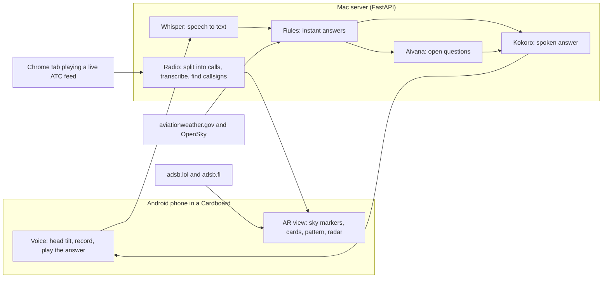

# Bombirdier

**Look up and see the airspace.** An AR trainer for people learning air traffic control: every plane in the sky is labelled, coloured by the controller working it, and tied to the live radio call that names it.

Built for **Wood County Regional Airport (1G0)** in Bowling Green, Ohio, home of the BGSU flight program.

| | |
|---|---|
| **For** | People learning air traffic control, flight students, plane fans |
| **Runs on** | An Android phone in a Google Cardboard, plus an Apple Silicon Mac |
| **Built with** | Aivana, Whisper and Kokoro (MLX), Capacitor, TypeScript, FastAPI |
| **Live data** | adsb.lol and adsb.fi (planes), live ATC audio, aviationweather.gov, OpenSky, OurAirports |
| **Try it** | [Run it](#run-it), then the [five-minute demo](#try-it-in-five-minutes). No phone needed: it also runs in a desktop browser |

## Inspiration

Someone learning air traffic control has to connect three things that normally live in three different places:

- the **plane** you can see in the sky,
- the **controller** responsible for it right now,
- the **words** being said to it on the radio.

A flight tracker shows the first, a chart hints at the second, a scanner plays the third, and nothing joins them up. Standing at the airfield you hear "descend and maintain three thousand" and have no idea which dot it was for.

We wanted to stand outside, look at a plane, and have all three in front of us.

## What it does

Put the phone in a Cardboard and look up.

- **See every plane where it really is.** Each aircraft gets a marker at its real spot in the sky. The one you look at gets a card: type, route, altitude, speed, and where it left from.
- **Read the traffic pattern.** The home field's runways and pattern are drawn in the sky and on the radar. Planes in the pattern are labelled with their leg ("Right downwind · RWY 28"). The runway in use is worked out from the traffic, then from the wind.
- **Tie the radio to the plane.** Live ATC calls are transcribed on the Mac. A call that names a plane lights that plane up, and its card quotes what was said.
- **See who controls what.** Say "show me the airspace" and every plane takes the colour of the controller working it. A plane told to "contact Detroit Approach" changes colour when the handoff is heard.
- **Listen in.** Look at a plane or a controller and say "Can I access?": that frequency plays on the phone with a scrolling transcript.
- **Ask, hands-free.** Tip your head to one side and talk. "What's that plane?", "what did they last say?", "when does it land?", "what's the weather at Detroit Metro?", "only show helicopters".
- **Everything within 250 nautical miles** is in a list you can filter and sort by voice.

## How Aivana is used

Aivana is the assistant's language model. It is called from one file, [mac-server/llm.py](mac-server/llm.py), and only for questions that need it.

- **Structured output.** Aivana has no tool calling, so every call passes a strict JSON Schema ([mac-server/tools.py](mac-server/tools.py)) and gets back `{ answer, actions }`: what to say aloud, and what to do in the app (open the list, filter it, change the radar, switch radio channel). There are 21 actions, and each one is checked again in our code before the phone carries it out.
- **Multi-turn.** The last three exchanges from the past two minutes are sent along, so a follow-up such as "and its range?" works after "how many seats does it have?".
- **Used where it helps.** Commands with one obvious meaning ("next page", "what's that plane?", "mute") are answered by rules in under a second and never reach Aivana, which took 3 to 6 seconds per call when measured. Open questions and anything with several conditions ("only Southwest above thirty thousand") go to it.
- **Grounded in live facts.** Aivana is given the plane in view, its last radio calls, the controller working it, the current weather report and the forecast as context, so it answers about this sky and not from memory.
- **No sums left to the model.** Distance flown, distance to go, arrival estimates, counts and unit conversions are worked out in code and given to Aivana as facts.
- **Token use.** Effort `low`, answers capped at 220 tokens, and the context is a few lines about the planes in view rather than the whole traffic picture.
- **When it fails.** One quick retry on a rate limit, a 20 second limit on waiting, and a spoken reason that matches the cause: no key, out of credit, spending limit reached, busy, or unreachable. Everything answered by rules keeps working.
- **Not used:** web search (tried for flight times and weather, and it returned wrong live data: see [docs/aivana.md](docs/aivana.md)), streaming, and image input.

## How we built it



| Part | How |
|---|---|
| **AR view** | Capacitor Android app in plain TypeScript. A canvas HUD drawn identically for each eye. Planes are placed with a pinhole projection from the phone's heading and pitch, with Earth curvature included. No computer vision. |
| **Traffic** | Two pollers: a fast one for the planes near you, a slow one for 250 nautical miles. Positions are moved forward between polls from speed and track. |
| **Pattern** | Runway geometry from FAA threshold coordinates. A classifier labels each plane's leg from position and track, checked against a recorded real landing. |
| **Voice** | Whisper on the Mac, then rules, then Aivana, then Kokoro for the spoken answer. All speech models run locally on the Mac. |
| **Radio** | The feed plays in its own web player in a Chrome tab. A small page captures the tab's sound, a splitter cuts it into calls at the pauses, Whisper transcribes each call, and a parser pulls out callsigns, pattern reports and handoffs. 16 channels across five controllers. |
| **Airspace** | Each plane's controller comes from the best evidence there is: a handoff heard, else its callsign heard on a frequency, else a guess from position and altitude (drawn fainter, and called "likely"). |

More detail on every part is in [CLAUDE.md](CLAUDE.md).

## Reliability and data handling

- **Two plane sources.** adsb.lol first, adsb.fi when it refuses or fails, each with its own cooldown. The last good data is kept on errors.
- **Stale data is not dressed up as fresh.** A plane that drops out of coverage is moved for at most 60 seconds past its last real report.
- **Model output is never trusted blindly.** Every action from Aivana is validated in code. An empty reply is treated as a failure and said aloud, not as silence.
- **Speech noise is filtered.** What Whisper invents from silence or static is dropped before it can become a question or a radio call.
- **Guesses are labelled.** Arrival times say they are estimates. A controller that was not heard is "likely". Weather names the station it came from and how far away it is.
- **Failures explain themselves.** A Wi-Fi that needs a sign-in page, a rate limit, Aivana out of credit: each gets its own plain message, and the rest of the app keeps working.
- **The server answers only its owner.** Requests from other machines need a token, oversized bodies are refused, and the Host header is checked.
- **No personal data.** Plane positions are public broadcasts. There are no accounts. See [Data and privacy](#data-and-privacy).
- **Tested without a network.** 558 checks across the app, the server and the radio parser, including a replay of a real landing.

## Challenges we ran into

- **Aivana has no tool calling.** The assistant has to work the app, not only talk. We get actions through strict JSON Schema output and validate each one.
- **Three to six seconds is a long time in a headset.** So the common commands never reach a model: rules answer them in under a second.
- **There is no API for live ATC audio.** LiveATC only offers its own web player and forbids other programs from using its streams. So the feed plays in its player in a Chrome tab and we capture the tab's sound. No stream address is in the code.
- **Whisper makes things up.** It writes sentences from silence, and it read our example radio calls back as transcripts. Prompts are now vocabulary only, and empty-sounding audio is dropped.
- **One wrong runway makes every label wrong.** We saw it on the first live landing. The runway in use is now worked out from the traffic itself.
- **Small planes file no flight plan.** There is no route to look up for a Cessna, so where it left from is worked out by watching it leave.
- **Rate limits left the sky empty** right after starting the app. A second plane source fixed it.
- **The language model's web search got live weather and flight times wrong.** Those now come from official reports and from sums done in code.

## What we're proud of

- **A real handoff, caught live.** The app heard a controller send a Republic flight to Cleveland Center on 119.87 and moved the plane to its new controller.
- **A real landing in the test suite.** A BGSU trainer landing on runway 18 was recorded and is replayed in every test run ([docs/recordings](docs/recordings)).
- **Sixteen live radio channels transcribed at once on one laptop.** In one hour we checked, that was 1,130 calls, 535 of them with a callsign found.
- **"What's that plane?" answered in under a second** (0.8 s measured on the Mac with test audio), with nothing leaving the Mac.

## What we learned

- **Most voice requests do not need a language model.** Saving it for the open questions made the app faster and the model's answers better.
- **The airspace was not what we assumed.** Wood County has no control tower: pilots announce themselves to each other. The app now shows that instead of inventing a controller.
- **Real ATC audio is far rougher than test audio.** Plain airline callsigns come out right; clipped and unusual ones often do not.
- **Saying "likely" is a feature.** A learning tool that states a guess as a fact teaches the wrong thing.

## What's next

- Break a call into its parts (who, instruction, readback) and check whether the plane then did it.
- "You be the controller": practise the call for a plane you are looking at.
- A replay mode with recorded traffic and radio, for cloudy days and classrooms.
- More airports. The pattern, runways and controller list are written for Wood County today.
- Real sector boundaries in place of the position-and-altitude guess.

## Run it

There are two parts: a server on a Mac (speech, the assistant, radio) and the app (a phone, or a desktop browser for trying it without one).

### 1. The Mac server

Needs an Apple Silicon Mac, Python 3.12 and `ffmpeg` (`brew install ffmpeg`).

```sh
cd mac-server
python3.12 -m venv .venv
.venv/bin/pip install -r requirements.txt
cp .env.example .env        # then put your Aivana key in it
./run.sh
```

The first start downloads the speech models (about 2 GB). It is ready when this answers `"whisper":"ready"`:

```sh
curl http://127.0.0.1:8787/api/health
```

The Aivana key lives only in `mac-server/.env`, which is gitignored. It is never sent to the phone and is not in this repository.

### 2a. In a desktop browser (no phone needed)

```sh
cd app/android
npm ci
npm run dev
```

Open `http://localhost:5174/?dev=1&at=41.391,-83.6301` (`at` is a fixed position: Wood County). Arrow keys look around, `V` talks (press again to send), `L` opens the plane list, `C` listens to the controller in view, `K` colours planes by controller. The full key list is at the end of the Bombirdier section of [CLAUDE.md](CLAUDE.md).

To send a typed question through the whole assistant, in the browser console:

```js
bombirdier.ask('show me the helicopters')
```

### 2b. On an Android phone

Build and install steps are in [app/android/README.md](app/android/README.md) (Node, the Android SDK and JDK 21):

```sh
cd app/android
npm ci
npm run apk
npm run install-apk
```

Plug the phone into the Mac: `run.sh` keeps the USB link to the server up, and the app finds it at its default address. The app asks for camera, location and microphone the first time.

## Try it in five minutes

1. Start the server and open the desktop link above (or the app on the phone, outdoors).
2. Look around until a plane's card drops down. Ask **"what's that plane?"**.
3. Ask **"when does it land?"** or **"where did it come from?"**.
4. Say **"show me the helicopters"**, then **"sort by altitude"**, then **"close the list"**.
5. Ask something open, such as **"how many seats does it have?"** (this one goes to Aivana and takes a few seconds).
6. Ask **"what's the weather?"**, or **"what's the weather at Detroit Metro?"**.
7. Say **"show me the airspace"**: every plane takes the colour of the controller working it, and a plane told to "contact" the next controller changes colour.
8. Say **"what can I say?"** for more.

On the phone, talking starts with a head tilt held for about a second, or two fingers on the screen when the phone is in your hand.

With the radio on (one more step, a Chrome tab playing the frequency: see "Radio feeds" in [mac-server/README.md](mac-server/README.md)):

9. Look at a plane and say **"Can I access?"** to hear the frequency it is probably on.
10. When a plane's card says it was heard, ask **"what did they last say?"**.

## Known limits

- **Arrival times are estimates** from distance and speed, and the answers say so. There is no free source of airline schedules.
- **Small planes have no route on file.** Where one left from is worked out by watching it, so it is only known for planes seen leaving, or when OpenSky has the track.
- **Radio transcripts are rough.** Plain airline callsigns usually come out right; clipped or unusual ones are often missed.
- **Who a plane is talking to is a guess** from its position and altitude until a call is actually heard. The app says "likely".
- **No sector boundaries are drawn.** The app has no real sector shapes, so the airspace view colours planes and draws no lines.
- **Traffic pattern labels** are tuned on one recorded landing so far.
- **Coverage.** Plane data comes from volunteer receivers (adsb.lol, adsb.fi). Planes without ADS-B, and planes low near a field with no receiver nearby, do not appear. Both sources limit how often they can be asked.
- **The compass** is unreliable indoors and near steel, which moves every marker sideways.
- **Networks with a sign-in page** block the plane data until you sign in; the app says so.
- **One airport.** The pattern, runways and controller list are written for Wood County.
- **Setup.** The assistant and radio need the Mac server on an Apple Silicon Mac. Without it the app still shows planes.
- Several features have been checked in the desktop preview but not yet in the headset: see the unticked items in [PROGRESS.md](PROGRESS.md).

## Data and privacy

- Plane positions are public ADS-B broadcasts. Weather is from aviationweather.gov, tracks from OpenSky, airfields from OurAirports.
- Your voice is transcribed on the Mac and not kept. Aivana receives the transcribed question and a few lines about nearby planes: no audio, and no location beyond "at Wood County" and distances.
- Radio audio is never saved. An optional text log of transcripts stays on the Mac.
- No accounts and no sign-up. The app's settings stay on the phone.

## Tests

```sh
cd app/android && npm test
cd mac-server && python3 test_server.py && python3 test_radio.py
```

No network and no model needed.

## Layout

| Folder | What |
|---|---|
| `app/android/` | The Capacitor Android app (Bombirdier lives here) |
| `web/` | Shared HUD, geometry, stereo view, orientation (also the original web app) |
| `mac-server/` | FastAPI server on the Mac: speech-to-text, the Aivana assistant, spoken answers, radio feeds |
| `flight-service/` | Original Python flight service (kept for normalization parity checks) |
| `voice-service/` | Original voice service (its prompt seeded the assistant) |
| `docs/` | Plan and reference docs |

## Team

Built by da squad.

- **Plan:** [docs/bombirdier-plan.md](docs/bombirdier-plan.md)
- **Progress:** [PROGRESS.md](PROGRESS.md) (plus one GitHub milestone and tracking issue per phase)
- **How the codebase works:** [CLAUDE.md](CLAUDE.md), [app/android/README.md](app/android/README.md) and [mac-server/README.md](mac-server/README.md)
